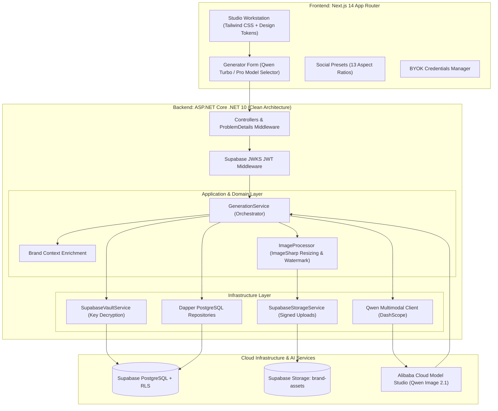

# YaaImg — Autonomous On-Brand Social Media Creative Engine

[](https://github.com/EMAD/yaaimg/actions/workflows/ci.yml)
[](https://dotnet.microsoft.com/)
[](https://nextjs.org/)
[](https://www.typescriptlang.org/)
[](https://supabase.com/)
[-FF6A00?logo=alibabacloud&logoColor=white)](https://help.aliyun.com/zh/model-studio/)
[](LICENSE)

> **YaaImg** is an enterprise-grade generative AI platform engineered to produce brand-consistent social media creatives at scale. By marrying **Alibaba Cloud Model Studio's Qwen Image 2.1** family with **ASP.NET Core (.NET 10) Clean Architecture** and **Next.js 14 (App Router)**, YaaImg eliminates the friction between raw AI prompting, brand guidelines, and platform-specific visual publishing.

---

## 🚀 Key Highlights & Capabilities

* **⚡ Dedicated Qwen Image 2.1 Multimodal Engine**:
  * **`qwen-image-2.1-turbo`**: Fast 8-step distilled generation engineered for rapid, daily social content iterations.
  * **`qwen-image-2.1-pro`**: Ultra high-fidelity generation with superior photorealism, fine material textures, and precise typography rendering.
* **🎯 Dimension-Perfect Social Presets**:
  * 13 standardized presets across 6 social networks (**Instagram, Facebook, X / Twitter, LinkedIn, TikTok, YouTube**).
  * Automated aspect ratio mapping with cover-scaling and center-cropping (zero image distortion or stretching).
* **🎨 Brand Kit Context Injection**:
  * Brand tone, color palettes, and identity summaries are automatically enriched into generative prompts on demand.
* **🛡️ BYOK (Bring Your Own Key) & Zero-Knowledge Architecture**:
  * Multi-tenant API key management where credentials are encrypted via **Supabase Vault** (authenticated AES-256-GCM). Plaintext keys never touch application persistent storage.
* **🖼️ Algorithmic Logo Compositing & Watermarking**:
  * Integrated **SixLabors.ImageSharp** pipeline for automated, proportional logo scaling, opacity blending, and margin-aware watermarking.
* **🔒 Enterprise Row-Level Security (RLS)**:
  * Strict multi-tenant data isolation at the PostgreSQL database engine level and Supabase Storage bucket policies.

---

## 🏛️ System Architecture

YaaImg adheres to the principles of **Clean Architecture** and **Domain-Driven Design (DDD)** in the backend, paired with a component-driven React Server / Client split in the frontend.



---

## 💻 Tech Stack & Engineering Rationale

| Layer | Technologies | Rationale |
|---|---|---|
| **Frontend** | Next.js 14, React 18, TypeScript, Tailwind CSS | High-performance Server-Side Rendering (SSR), App Router layout virtualization, responsive design tokens. |
| **Backend API** | ASP.NET Core (.NET 10), C# 14, `.slnx` solution | Modern, high-throughput asynchronous request pipeline with minimal allocation overhead. |
| **Architecture** | Clean Architecture (Domain, Application, Contracts, Infrastructure, API) | Strict inversion of dependencies; domain models are isolated from external SDKs. |
| **Data & ORM** | Supabase PostgreSQL, Dapper | High-performance micro-ORM queries with compile-safe SQL mappings, PostgreSQL `enum` support. |
| **Security & Auth** | Supabase Auth (JWKS / RS256), Supabase Vault (AES-GCM), Storage RLS | Cryptographic token validation, zero-knowledge BYOK key storage, and storage bucket security. |
| **Image Processing**| SixLabors.ImageSharp | High-speed, memory-managed image resampling, aspect ratio conforming, and alpha watermark blending. |
| **AI Model Studio** | Alibaba Cloud Model Studio (Qwen Image 2.1 Turbo & Pro) | State-of-the-art visual aesthetics, fast 8-step inference, and advanced typography handling. |
| **CI / CD** | GitHub Actions (`ubuntu-latest` parallel runners) | Automated dual-job quality gate enforcing 0 build warnings, 0 type-check errors, and package caching. |

---

## 📂 Repository Monorepo Structure

```text
yaaimg/
├── .github/
│   └── workflows/
│       └── ci.yml               # Automated parallel CI pipeline (.NET 10 + Next.js 14)
├── apps/
│   ├── api/                     # Backend ASP.NET Core (.NET 10) Solution
│   │   └── src/
│   │       ├── YaaImg.slnx      # Solution definition
│   │       ├── YaaImg.Api/      # REST API Controllers & Middleware
│   │       ├── YaaImg.Application/ # Business logic, orchestration & interfaces
│   │       ├── YaaImg.Contracts/   # Data transfer objects (DTOs)
│   │       ├── YaaImg.Domain/      # Pure entities & domain exceptions
│   │       └── YaaImg.Infrastructure/ # Repositories, Vault, ImageSharp & Qwen client
│   └── web/                     # Frontend Next.js 14 App Router
│       ├── app/                 # App Router pages (Dashboard, Studio, Keys, History, Admin)
│       ├── components/          # Design system, Generator form, Presets, Key cards
│       ├── hooks/               # Custom React hooks (use-generation, use-keys)
│       └── types/               # TypeScript domain contracts
├── supabase/
│   └── migrations/              # PostgreSQL DDL, schema, enums & RLS policies
├── .gitignore                   # Hardened git ignore rules
├── make.bat                     # Windows CLI developer ergonomics script
└── README.md                    # Project documentation
```

---

## 🛠️ Local Development & Quickstart

### Prerequisites
* [.NET 10.0 SDK](https://dotnet.microsoft.com/download)
* [Node.js 20+ & npm](https://nodejs.org/)
* [Supabase CLI](https://supabase.com/docs/guides/cli) or an active Supabase Cloud project

### 1. Clone & Environment Setup
```bash
git clone https://github.com/EMAD/yaaimg.git
cd yaaimg
```

Copy the environment templates and supply your configuration:
```bash
# In apps/web:
cp .env.example .env.local

# In repository root (for API & Supabase):
cp .env.example .env
```

### 2. Run Database Migrations
```bash
./make.bat db-push
# or: npx supabase db push
```

### 3. Launch Development Servers

You can run both servers side-by-side using the convenience script:

```bash
# Terminal 1: Backend API (Listening on http://localhost:5000)
./make.bat dev-backend

# Terminal 2: Frontend Web (Listening on http://localhost:3000)
./make.bat dev-frontend
```

* **Frontend Workstation**: [`http://localhost:3000`](http://localhost:3000)
* **Swagger API Documentation**: [`http://localhost:5000/swagger`](http://localhost:5000/swagger)

---

## 🧪 CI/CD Quality Gate

Every commit and pull request to `main` is validated automatically by **GitHub Actions** across two parallel isolated jobs:

```bash
# Backend Quality Check
dotnet build apps/api/src/YaaImg.slnx --configuration Release

# Frontend Quality Check
cd apps/web && npm ci && npm run build
```

Both jobs must pass with **0 warnings and 0 errors** to achieve the green verification badge.

---

## 📄 License

This project is licensed under the [MIT License](LICENSE).
