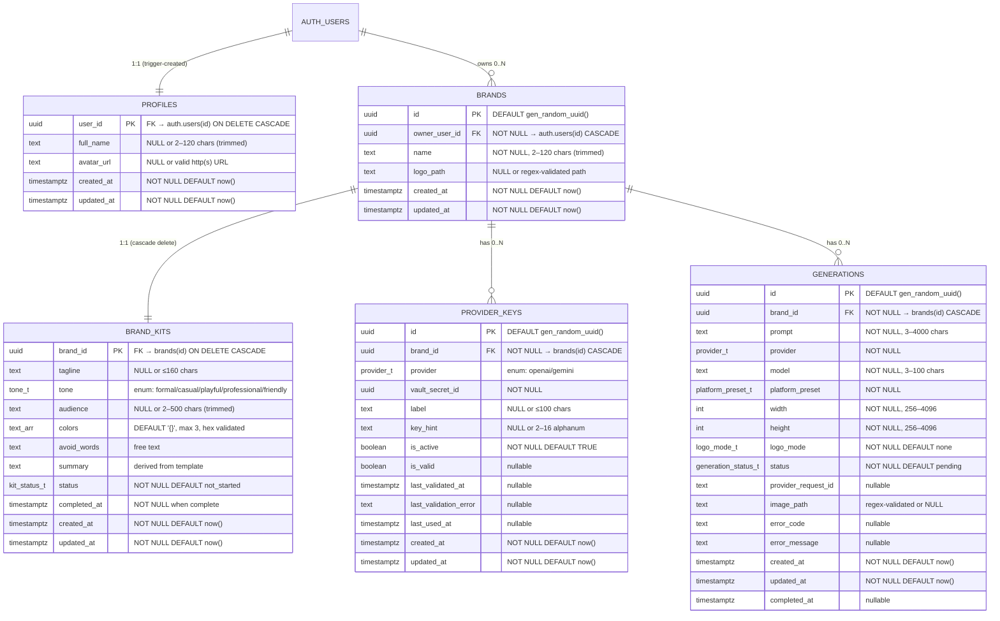

# Data Model: Foundation

**Feature**: `001-foundation` | **Date**: 2026-07-09

## Entity Relationship Diagram



## Custom Types (Enums)

| Type | Values | Used By |
|------|--------|---------|
| `provider_t` | `openai`, `gemini` | `provider_keys.provider`, `generations.provider` |
| `tone_t` | `formal`, `casual`, `playful`, `professional`, `friendly` | `brand_kits.tone` |
| `logo_mode_t` | `none`, `prompt`, `watermark`, `both` | `generations.logo_mode` |
| `kit_status_t` | `not_started`, `in_progress`, `complete` | `brand_kits.status` |
| `generation_status_t` | `pending`, `processing`, `succeeded`, `failed` | `generations.status` |
| `platform_preset_t` | 13 values (instagram_post, instagram_story, ...) | `generations.platform_preset` |

## Helper Functions

| Function | Purpose |
|----------|---------|
| `set_updated_at()` | Trigger function: sets `NEW.updated_at = now()` before UPDATE |
| `all_hex_colors(TEXT[])` | Validates every element matches `^#[0-9A-F]{6}$` |
| `is_brand_owner(UUID)` | SECURITY DEFINER: checks if `auth.uid()` owns the given brand |
| `handle_new_user()` | Trigger function: inserts a `profiles` row on `auth.users` INSERT |

## Indexes

| Table | Index | Type | Purpose |
|-------|-------|------|---------|
| `brands` | `uq_brands_owner_name_ci` | UNIQUE (owner_user_id, lower(name)) | Case-insensitive unique brand names per user |
| `brands` | `idx_brands_owner_created` | B-tree (owner_user_id, created_at DESC) | List brands query |
| `provider_keys` | `uq_provider_keys_one_active` | UNIQUE partial WHERE is_active | One active key per brand/provider |
| `provider_keys` | `idx_provider_keys_lookup` | B-tree (brand_id, provider, created_at DESC) | Key lookup query |
| `generations` | `idx_generations_brand_created` | B-tree (brand_id, created_at DESC) | History list |
| `generations` | `idx_generations_brand_status_created` | B-tree (brand_id, status, created_at DESC) | Status filter |
| `generations` | `idx_generations_brand_provider_created` | B-tree (brand_id, provider, created_at DESC) | Provider filter |

## Constraints Summary

### profiles
- PK: `user_id` (FK → auth.users CASCADE)
- `full_name`: NULL or trimmed length 2–120
- `avatar_url`: NULL or matches `^https?://.+`

### brands
- PK: `id` (auto UUID)
- `owner_user_id`: NOT NULL FK → auth.users CASCADE
- `name`: NOT NULL, trimmed length 2–120
- `logo_path`: NULL or matches `^brands/[0-9a-f-]+/logo\.[A-Za-z0-9]+$`
- Unique: (owner_user_id, lower(name))

### brand_kits
- PK: `brand_id` (FK → brands CASCADE)
- `colors`: max 3 elements, all valid hex
- `complete` status requires tone, audience, and ≥1 color
- `completed_at` must be non-null iff status = `complete`

### provider_keys
- PK: `id` (auto UUID)
- `brand_id`: NOT NULL FK → brands CASCADE
- Partial unique: one active key per (brand_id, provider)
- `key_hint`: NULL or matches `^[A-Za-z0-9_-]{2,16}$`

### generations
- PK: `id` (auto UUID)
- `brand_id`: NOT NULL FK → brands CASCADE
- `prompt`: trimmed length 3–4000
- `model`: length 3–100
- `width`/`height`: 256–4096
- `image_path`: NULL or matches `^brands/[0-9a-f-]+/generations/[0-9a-f-]+\.png$`
- Status-dependent constraint: succeeded requires image_path + completed_at; failed requires error_code + completed_at; pending/processing requires all NULL

## Row Level Security

| Table | Policy | Rule |
|-------|--------|------|
| `profiles` | `profiles_owner_all` | ALL: `user_id = auth.uid()` |
| `brands` | `brands_select/insert/update/delete` | Per-operation: `owner_user_id = auth.uid()` |
| `brand_kits` | `brand_kits_owner_all` | ALL: `is_brand_owner(brand_id)` |
| `provider_keys` | `provider_keys_owner_all` | ALL: `is_brand_owner(brand_id)` |
| `generations` | `generations_owner_all` | ALL: `is_brand_owner(brand_id)` |

All tables have `ENABLE ROW LEVEL SECURITY` and `FORCE ROW LEVEL SECURITY`.

## State Transitions

### Brand Kit Status
```
not_started → in_progress → complete
     ↑              ↓
     └──────────────┘ (edit after complete reverts to in_progress)
```

### Generation Status
```
pending → processing → succeeded
                    ↘ failed
```
No automatic transitions back. Failed is terminal. New generation required for retry.

## Storage

| Bucket | Access | Paths |
|--------|--------|-------|
| `brand-assets` | Public (unguessable UUIDs) | `brands/{brandId}/logo.{ext}` — brand logo |
| | | `brands/{brandId}/generations/{generationId}.png` — generated image |

## Triggers

Every table has a `BEFORE UPDATE` trigger executing `set_updated_at()` to auto-maintain `updated_at`.

Additionally: `on_auth_user_created` trigger on `auth.users` executes `handle_new_user()` to auto-create a `profiles` row.
